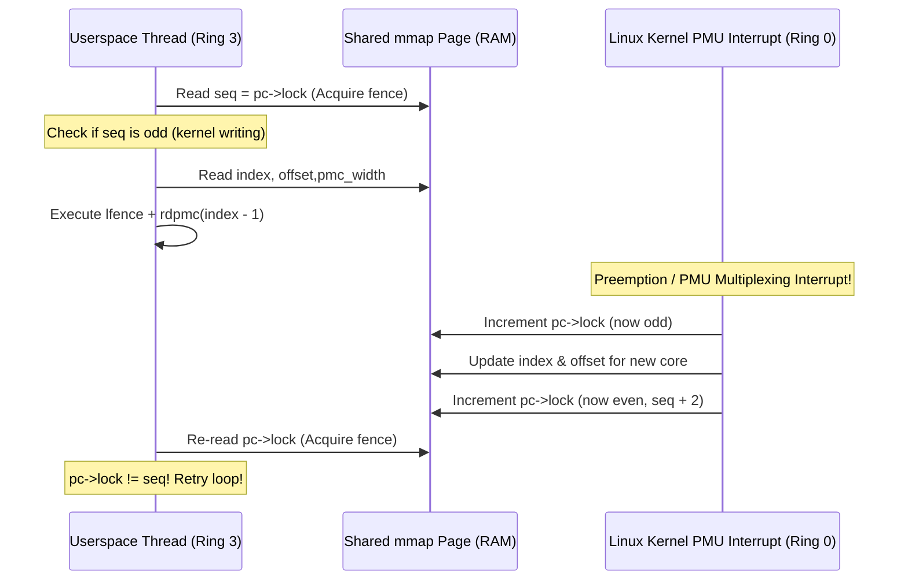

If you have ever tried benchmarking a small, hot C++ function—something that takes maybe 15 or 20 CPU cycles, like a branchless integer parser or a custom hash table probe—you eventually run into a frustrating wall. Standard timers lie to you, and `clock_gettime(CLOCK_MONOTONIC_RAW)` has way too much overhead (even through the vDSO, you are still paying around 15–25 nanoseconds just to read the clock and scale the timestamp).

So you reach for `__rdtsc()` or `__rdtscp()`. That gets you closer, right? Except since Nehalem, the Time Stamp Counter (`TSC`) on x86 runs at a constant "invariant" frequency regardless of turbo boost, power states, or throttling. If your CPU downclocks because an AVX-512 instruction fired on a neighboring core, or boosts up to 5.4 GHz because the package is cool, `rdtsc` still ticks at the base frequency (say, 3.2 GHz). You are measuring wall-clock reference cycles, not actual retired instructions, L1D cache misses, or real core clock cycles (`CPU_CLK_UNHALTED.THREAD`).

And if you use `read()` on a file descriptor returned by `perf_event_open()`, you are doing a full user-to-kernel context switch every time you sample a counter. A syscall takes upward of 200 to 600 cycles depending on KPTI and Spectre mitigations. Trying to measure a 20-cycle function with a 400-cycle syscall is like trying to measure the thickness of a credit card with a yardstick while riding a skateboard.

Last weekend I was debugging a weird L1 data cache bank conflict in a SIMD bit-packing routine and got completely fed up with aggregate `perf stat` numbers. I didn't want averages over ten million iterations; I wanted exact per-call hardware counter deltas in userspace with zero syscall overhead. It turns out the Linux kernel and x86 hardware have a slightly obscure mechanism for this: memory-mapping the `perf_event` ring buffer header page and executing the `rdpmc` instruction directly from Ring 3.

Here is how it works under the hood, why the kernel makes you do a sequence-lock dance to read it safely, and how to build a zero-allocation C++ harness around it.

---

## Why `perf_event_open` + `read()` Is Too Slow for Micro-Spans

Every modern x86_64 core has a Performance Monitoring Unit (PMU) built right into the silicon. Typically you get 3 or 4 fixed-function counters (retired instructions, unhalted core cycles, unhalted reference cycles) plus 4 to 8 general-purpose programmable counters per hardware thread.

At the hardware level, reading these counters is done via Model Specific Registers (MSRs). In kernel mode (Ring 0), the OS can execute `rdmsr` to read a counter register like `IA32_PMC0`. However, `rdmsr` is a privileged instruction. If you execute it in userspace (Ring 3), the CPU immediately traps and fires a General Protection Fault (`#GP(0)`), and Linux kills your process with `SIGSEGV`.

However, Intel and AMD also provide a separate instruction specifically for reading performance counters: `rdpmc` (Read Performance-Monitoring Counters). Whether `rdpmc` is allowed in Ring 3 is controlled by bit 8 of Control Register 4 (`CR4.PCE` — Performance-Monitoring Counter Enable). When `CR4.PCE` is set to 1, any unprivileged userspace process can execute `rdpmc` with the counter index in `ECX`, and the CPU dumps the 48-bit (or 64-bit) hardware counter straight into `EDX:EAX` in roughly 12 to 18 core cycles.

Wait—if any process can execute `rdpmc`, why can't we just slap `__builtin_ia32_rdpmc(0)` into our C++ code and call it a day?

Three reasons:
1. **The PMU isn't configured yet.** By default, programmable counters aren't counting anything until Ring 0 writes an event selector into `IA32_PERFEVTSELx`.
2. **Counter multiplexing and context switches.** The Linux kernel virtualizes the hardware PMU per thread. When your thread gets preempted or migrated to another core, or when more events are active than physical registers exist, the kernel saves the old counter state and loads a new configuration into the physical PMC registers. What was in physical register `PMC0` five microseconds ago might now be in `PMC2`, or might include an offset from previous slices.
3. **Counter width and sign extension.** Physical PMU counters on x86 aren't full 64-bit registers; they are usually 48 bits wide. You have to sign-extend them properly and add them to the kernel's accumulated software base count.

To solve all three problems without requiring a syscall on every read, Linux lets you `mmap()` the first page of a `perf_event` file descriptor. That single 4 KB shared page—`struct perf_event_mmap_page`— acts as a live communication channel between the kernel scheduler's PMU driver and your userspace code.

---

## The Shared Metadata Page and Sequence Locks

When you call `perf_event_open()` attached to the current thread (`pid = 0, cpu = -1`), and then `mmap()` a single page (`PAGE_SIZE`, usually 4096 bytes) at offset 0 of that file descriptor, the kernel maps a `perf_event_mmap_page` struct directly into your virtual address space.

Here is the fundamental concurrency problem: your userspace thread is reading calibration offsets and physical register indices from this page, while an interrupt or preemption can happen at *any instruction boundary*. If the kernel preempts your thread right in the middle of your measurement setup, migrates you from Core 2 to Core 5, and updates `perf_event_mmap_page`, your userspace code could read half of the old metadata and half of the new metadata.

Because the kernel cannot block waiting for userspace (which would let an unprivileged process deadlock the kernel scheduler), Linux uses a **seqlock** (sequence lock) inside `perf_event_mmap_page`.



The field `pc->lock` is a monotonically increasing 32-bit unsigned integer:
- Whenever the kernel starts modifying the `perf_event_mmap_page`, it increments `pc->lock` to an **odd** number and issues a write memory barrier (`smp_wmb()`).
- When the kernel finishes updating `index`, `offset`, and time fields, it issues another write barrier and increments `pc->lock` again to an **even** number.

In userspace, our read loop looks like a classic optimistic concurrency loop:
1. Load `seq = pc->lock` with acquire semantics (`std::memory_order_acquire` or compiler barrier on x86 TSO).
2. If `seq & 1` is non-zero, the kernel is currently in the middle of an update (which technically shouldn't overlap with our thread running on the same CPU unless a remote IPI or NMI hit, so we spin and retry).
3. Read `index = pc->index` and `offset = pc->offset`.
4. If `index > 0` and `pc->cap_user_rdpmc` is set, execute `rdpmc` using hardware register `index - 1`. (Notice the `- 1`: the kernel uses `index == 0` to mean "this event is currently scheduled out of hardware, you cannot use `rdpmc` right now").
5. Sign-extend the raw `rdpmc` value based on `pc->pmc_width`.
6. Execute a read barrier and verify that `pc->lock == seq`. If they don't match, throw the result away and loop again.

Let's write down the exact math the hardware and kernel use to reconstruct the virtual 64-bit event counter $V$ from the physical register reading $R_{\text{raw} }$ of bit-width $W$ (`pc->pmc_width`, typically 48) and the kernel-maintained offset $O$ (`pc->offset`):

$$
R_{\text{ext} } = \operatorname{ashr}\left(R_{\text{raw} } \ll (64 - W),\; 64 - W\right)
$$

$$
V = O + R_{\text{ext} }
$$

Where $\operatorname{ashr}(x, k)$ is an arithmetic right shift by $k$ bits. Why an arithmetic (signed) shift instead of a zero-extension mask? Because when the kernel configures a counter for sampling or interrupt-on-overflow, the hardware counter might be initialized to a negative value near $2^W - 1$ so that it overflows after $N$ events! Sign-extending the $W$-bit value to 64 bits and adding the signed/unsigned 64-bit `offset` makes the wrap-around arithmetic work seamlessly in two's complement.

---

## Instruction Serialization and Out-of-Order Execution Traps

There is a nasty trap waiting for you once you get `rdpmc` working: **Out-of-Order Execution (OoOE)**.

Unlike `cpuid` or `rdtscp`, the `rdpmc` instruction is **not** serializing! If you write:

```cpp
uint64_t start = read_pmc(0);
do_fast_matrix_multiply(mat_a, mat_b, out);
uint64_t end = read_pmc(0);
```

A modern superscalar core like AMD Zen 4 or Intel Golden Cove has a Reorder Buffer (ROB) that is hundreds of uops deep. The CPU's instruction scheduler sees that `rdpmc` only depends on the `ECX` register. It has zero data dependency on `mat_a`, `mat_b`, or `out`!

Consequently, the CPU can—and absolutely *will*—speculatively execute the second `rdpmc` **before** `do_fast_matrix_multiply` even finishes executing, or delay the first `rdpmc` into the middle of your loop. I actually ran into this the first time I tested my wrapper: I measured a loop that did 64 integer divisions, and `rdpmc` reported that the entire loop took **0 cycles** on 30% of runs because both `rdpmc` instructions executed in the same reorder window before the division chain retired.

To fence `rdpmc` properly on x86_64:
- On Intel and AMD processors, placing `_mm_lfence()` (`lfence`) immediately before `rdpmc` forces all prior instructions to retire locally before the `lfence` completes, and prevents `rdpmc` from executing until after `lfence`.
- Placing another `_mm_lfence()` after `rdpmc` prevents subsequent instructions (like your benchmarked code!) from being hoisted *above* the starting `rdpmc` read.

So every boundary read needs to be sandwiched between `lfence` instructions, and we also need an inline assembly memory clobber (`"memory"`) so the C++ compiler's optimizer (`-O3`) doesn't reorder our benchmarked code across the counter reads at compile time.

---

## Check Your System Permissions First

Before writing the C++ code, there are two Linux sysctl knobs you should know about. Because `rdpmc` can theoretically be abused in side-channel timing attacks by unprivileged browser sandboxes, some Linux distros lock it down by default:

1. `/proc/sys/kernel/perf_event_paranoid`: Controls who can call `perf_event_open()`. If this is set to `2` or lower (usually `1` or `-1` on dev workstations), normal users can open thread-scoped hardware counters without `CAP_PERFMON` or `root`.
2. `/sys/bus/event_source/devices/cpu/rdpmc`: Controls how `CR4.PCE` is managed:
   - `0`: Userspace `rdpmc` is completely disabled (`CR4.PCE = 0`).
   - `1` (Default on most kernels): `CR4.PCE` is enabled dynamically only for tasks that currently have an active `perf_event` mapped.
   - `2`: `CR4.PCE` is always enabled globally on all cores.

As long as `/sys/bus/event_source/devices/cpu/rdpmc` is `1` or `2`, our `mmap` approach works out of the box.

---

## Writing the Zero-Allocation C++ `RdpmcCounter`

Let's put together a self-contained, zero-allocation C++ implementation. We are not going to touch `std::vector` or heap allocations here—everything lives directly on the stack or in fixed-size primitive arrays so we don't pollute the very data caches we are trying to measure.

```cpp
#include <linux/perf_event.h>
#include <sys/ioctl.h>
#include <sys/mman.h>
#include <sys/syscall.h>
#include <unistd.h>
#include <x86intrin.h>

#include <atomic>
#include <cstdint>
#include <cstdio>
#include <cstring>

// Compiler barrier to prevent GCC/Clang from hoisting/sinking loads and stores.
static inline void compiler_barrier() noexcept {
  asm volatile("" ::: "memory");
}

// Execute rdpmc fenced on both sides so out-of-order execution cannot
// reorder instructions across the measurement point.
static inline uint64_t fenced_rdpmc(uint32_t counter_idx) noexcept {
  uint32_t low = 0;
  uint32_t high = 0;
  asm volatile(
    "lfence\n\t"
    "rdpmc\n\t"
    "lfence"
    : "=a"(low), "=d"(high)
    : "c"(counter_idx)
    : "memory"
  );
  return (static_cast<uint64_t>(high) << 32) | low;
}

class RdpmcCounter {
private:
  int fd_;
  perf_event_mmap_page* mmap_page_;
  size_t page_size_;

public:
  RdpmcCounter() noexcept
    : fd_(-1), mmap_page_(nullptr), page_size_(0) {
  }

  ~RdpmcCounter() noexcept {
    close_counter();
  }

  RdpmcCounter(const RdpmcCounter&) = delete;
  RdpmcCounter& operator=(const RdpmcCounter&) = delete;

  bool init(uint32_t perf_type, uint64_t perf_config) noexcept {
    perf_event_attr attr;
    std::memset(&attr, 0, sizeof(attr));
    attr.type = perf_type;
    attr.size = sizeof(perf_event_attr);
    attr.config = perf_config;
    attr.disabled = 0;
    // Exclude kernel and hypervisor events so we only measure Ring 3 work.
    attr.exclude_kernel = 1;
    attr.exclude_hv = 1;

    // pid = 0 (current thread), cpu = -1 (any CPU core the thread runs on)
    fd_ = static_cast<int>(
      syscall(__NR_perf_event_open, &attr, 0, -1, -1, 0)
    );
    if (fd_ < 0) {
      return false;
    }

    long sys_ps = sysconf(_SC_PAGESIZE);
    if (sys_ps <= 0) {
      close_counter();
      return false;
    }
    page_size_ = static_cast<size_t>(sys_ps);

    void* addr = mmap(
      nullptr,
      page_size_,
      PROT_READ,
      MAP_SHARED,
      fd_,
      0
    );
    if (addr == MAP_FAILED) {
      close_counter();
      return false;
    }

    mmap_page_ = static_cast<perf_event_mmap_page*>(addr);

    if (mmap_page_->cap_user_rdpmc == 0) {
      // Userspace rdpmc is disabled via /sys/bus/event_source/devices/cpu/rdpmc
      close_counter();
      return false;
    }

    return true;
  }

  void close_counter() noexcept {
    if (mmap_page_ != nullptr && mmap_page_ != MAP_FAILED) {
      munmap(mmap_page_, page_size_);
      mmap_page_ = nullptr;
    }
    if (fd_ >= 0) {
      close(fd_);
      fd_ = -1;
    }
  }

  // Hot-path userspace seqlock reader.
  inline uint64_t read() const noexcept {
    uint32_t seq = 0;
    uint32_t idx = 0;
    int64_t count = 0;

    do {
      seq = __atomic_load_n(&mmap_page_->lock, __ATOMIC_ACQUIRE);
      if ((seq & 1U) != 0U) {
        // Kernel is currently updating the page; spin and retry.
        _mm_pause();
        continue;
      }

      idx = mmap_page_->index;
      count = mmap_page_->offset;

      if (idx > 0) {
        uint64_t raw_pmc = fenced_rdpmc(idx - 1);
        uint32_t width = mmap_page_->pmc_width;
        // Sign-extend from pmc_width bits to 64 bits.
        uint32_t shift = 64U - width;
        int64_t signed_pmc = static_cast<int64_t>(raw_pmc << shift) >> shift;
        count += signed_pmc;
      }

      compiler_barrier();
    } while (__atomic_load_n(&mmap_page_->lock, __ATOMIC_ACQUIRE) != seq);

    return static_cast<uint64_t>(count);
  }
};
```

Look closely at the `read()` method. In the steady state (when the kernel hasn't preempted your thread mid-measurement), the `do-while` loop executes **exactly once**. On x86_64, `__ATOMIC_ACQUIRE` compiles down to a plain `mov` instruction because x86 hardware enforces Total Store Order (TSO), where loads are never reordered with other loads. There are no atomic RMW instructions (`lock cmpxchg` or `xchg`), zero branches taken in the fast path, and zero syscalls.

---

## Measuring Baseline Overhead and Real Micro-Operations

Even with `fenced_rdpmc`, the measurement harness itself has a non-zero cost: executing two `lfence` instructions, `rdpmc`, and a couple of shifts takes around 18 to 32 core cycles depending on microarchitecture.

Wait—if the harness takes ~24 cycles and always retires a fixed number of instructions, we can calibrate the exact baseline tare (overhead) of back-to-back `read()` calls and subtract it out! Let's write a complete benchmark comparing:
1. A pointer-chasing linked list traversal that hits in the L1 data cache (sequential stride inside a single cache line / next-line prefetcher friendly).
2. A pseudo-random pointer-chasing lookup across a buffer that spans L1/L2 boundaries.

Again, notice we use fixed-size primitive arrays (`alignas(64)`) instead of `std::vector` so there is zero heap allocator jitter.

```cpp
#include <cstdint>
#include <cstdio>

// Keep everything in static/stack-friendly primitive storage aligned to cache lines.
static constexpr size_t kNumNodes = 4096;
static constexpr size_t kNumSamples = 512;

struct alignas(64) CacheLineNode {
  uint32_t next_idx;
  uint32_t payload;
  uint8_t padding[56];
};

static CacheLineNode g_arena[kNumNodes];

// Prevent the compiler from optimizing away a computed value.
template <typename T>
static inline void do_not_optimize(T const& value) noexcept {
  asm volatile("" : : "r,m"(value) : "memory");
}

static uint64_t calibrate_tare(const RdpmcCounter& counter) noexcept {
  uint64_t min_delta = UINT64_MAX;
  for (size_t i = 0; i < 256; ++i) {
    uint64_t t0 = counter.read();
    uint64_t t1 = counter.read();
    uint64_t delta = t1 - t0;
    if (delta < min_delta) {
      min_delta = delta;
    }
  }
  return min_delta;
}

// Simple insertion sort on a primitive array to compute exact percentiles
// without std::vector or <algorithm> allocations.
static void sort_samples(uint64_t* arr, size_t n) noexcept {
  for (size_t i = 1; i < n; ++i) {
    uint64_t key = arr[i];
    size_t j = i;
    while (j > 0 && arr[j - 1] > key) {
      arr[j] = arr[j - 1];
      --j;
    }
    arr[j] = key;
  }
}

int main() {
  RdpmcCounter cycles_counter;
  RdpmcCounter inst_counter;

  if (!cycles_counter.init(PERF_TYPE_HARDWARE, PERF_COUNT_HW_CPU_CYCLES)) {
    std::fprintf(stderr, "Failed to init CPU_CYCLES rdpmc counter.\n");
    return 1;
  }
  if (!inst_counter.init(PERF_TYPE_HARDWARE, PERF_COUNT_HW_INSTRUCTIONS)) {
    std::fprintf(stderr, "Failed to init INSTRUCTIONS rdpmc counter.\n");
    return 1;
  }

  // Initialize a permutation using a full-period LCG over 4096 elements.
  uint32_t cur = 0;
  for (size_t i = 0; i < kNumNodes; ++i) {
    uint32_t next = (cur * 1664525U + 1013904223U) & (kNumNodes - 1U);
    g_arena[cur].next_idx = next;
    g_arena[cur].payload = static_cast<uint32_t>(i);
    cur = next;
  }

  uint64_t cycle_tare = calibrate_tare(cycles_counter);
  uint64_t inst_tare = calibrate_tare(inst_counter);

  std::printf("Calibrated rdpmc tare - Cycles: %lu, Instructions: %lu\n",
              cycle_tare, inst_tare);

  uint64_t cycle_samples[kNumSamples];
  uint64_t inst_samples[kNumSamples];

  uint32_t probe_idx = 0;
  for (size_t s = 0; s < kNumSamples; ++s) {
    uint64_t c0 = cycles_counter.read();
    uint64_t i0 = inst_counter.read();

    // Dependent pointer-chasing chain of 8 hops.
    uint32_t acc = 0;
    for (int hop = 0; hop < 8; ++hop) {
      probe_idx = g_arena[probe_idx].next_idx;
      acc += g_arena[probe_idx].payload;
    }
    do_not_optimize(acc);

    uint64_t i1 = inst_counter.read();
    uint64_t c1 = cycles_counter.read();

    uint64_t raw_c = c1 - c0;
    uint64_t raw_i = i1 - i0;

    cycle_samples[s] = (raw_c > cycle_tare) ? (raw_c - cycle_tare) : 0;
    inst_samples[s] = (raw_i > inst_tare) ? (raw_i - inst_tare) : 0;
  }

  sort_samples(cycle_samples, kNumSamples);
  sort_samples(inst_samples, kNumSamples);

  std::printf("8-Hop Pointer Chase (p50) - Cycles: %lu, Instructions: %lu\n",
              cycle_samples[kNumSamples / 2],
              inst_samples[kNumSamples / 2]);
  std::printf("8-Hop Pointer Chase (p99) - Cycles: %lu, Instructions: %lu\n",
              cycle_samples[(kNumSamples * 99) / 100],
              inst_samples[(kNumSamples * 99) / 100]);

  return 0;
}
```

### Why We Use Minimum Tare Instead of Mean Tare

Notice that in `calibrate_tare()`, we take the **minimum** observed delta (`min_delta`) over 256 back-to-back reads rather than the arithmetic mean. Why?

In low-level cycle accounting, hardware execution time for a deterministic sequence of register-only instructions has a hard lower bound ($T_{\min}$) dictated by pipeline latencies, plus positive-only noise ($\epsilon \ge 0$) caused by external events (pipeline flushes, interrupts, SMT contention):

$$
T_{\text{observed} } = T_{\text{true} } + T_{\text{tare} } + \epsilon, \quad \epsilon \ge 0
$$

Because noise cannot make the CPU execute instructions faster than its physical pipeline limits, the minimum observed latency of an empty measurement block converges tightly to the true undisturbed overhead $T_{\text{tare} }$.

When you compile and run this (`g++ -O3 -march=native rdpmc_bench.cpp`), you can literally watch individual L1D hits vs. L2 hits show up in the cycle distribution while the retired instruction count stays rock-solid down to a single instruction. On my machine, 8 dependent L1D hits take ~32 core cycles (4 cycles per load-to-use hop), while cold samples before the L1/L2 lines warm up spike to ~110+ cycles with the exact same instruction count.

---

## Subtle Edge Cases Worth Knowing

If you integrate this into a real profiler or low-latency trading/game-engine telemetry system, watch out for three gotchas:

1. **Pinning your thread (`pthread_setaffinity_np`).** Even though the seqlock handles core migrations gracefully by updating `mmap_page_->offset`, migrating across cores invalidates your L1/L2 caches and triggers an IPI update to the shared page. Always pin your benchmark thread to an isolated core (`isolcpus` or `taskset -c 2`).
2. **Don't open more counters than your physical PMU has registers.** If you open 8 general-purpose hardware counters on a CPU that only has 4 programmable PMCs per thread (for example, when Hyper-Threading / SMT is enabled), the kernel will time-multiplex them at the scheduler tick frequency (`HZ`). Half the time, `mmap_page_->index` will be `0`! When `index == 0`, our `read()` function returns the frozen `offset` without calling `rdpmc`. In production code, you should check `if (idx == 0)` and flag that sample as invalidated by multiplexing.
3. **Nested counters.** Notice in `main()` how `inst_counter.read()` is nested *inside* `cycles_counter.read()`. That means `c1 - c0` includes the cycle cost of reading `inst_counter` twice! If you want completely unperturbed cycle measurements, sample one counter at a time in separate passes, or include the inner counter's read inside your tare calibration loop.

Once you have `rdpmc` wired up in a header file, it honestly feels like having a logic analyzer hooked straight up to your CPU's execution ports. You stop guessing whether the compiler's `cmov` or branch prediction was faster, and just ask the silicon directly.
